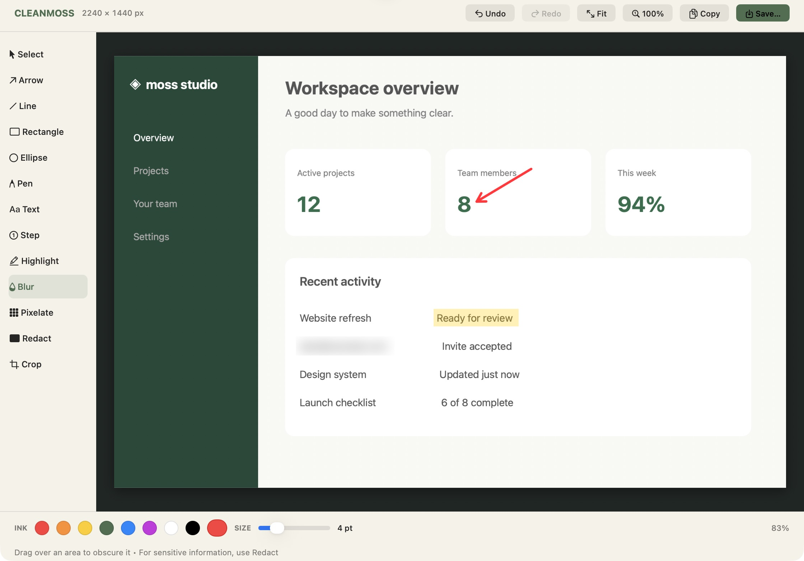

# Cleanmoss

A native macOS menu bar app for capturing a selected area, annotating it, and copying or saving the result. Includes blur, pixelation, redaction, and crop.



## Build from source

Requires macOS 14 or later and Apple’s Command Line Tools (`xcode-select --install`).

```sh
git clone https://github.com/nadeesha/cleanmoss.git
cd cleanmoss
make build
./dist/cleanmoss install
```

`make build` produces `dist/Cleanmoss.app` and `dist/cleanmoss`. Use `make universal` to build for both Apple Silicon and Intel, or `make test` to run the checks.

Press **⌘⇧4** to capture an area. On first capture, grant Cleanmoss Screen Recording permission in System Settings. The installer reserves that shortcut for Cleanmoss and restores the previous system setting on uninstall; pass `--keep-system-shortcut` to leave it alone.

Run `~/.local/bin/cleanmoss help` for configuration and uninstall commands.
